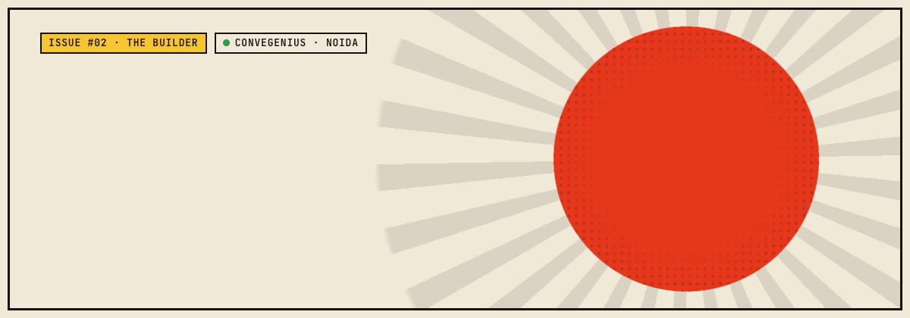
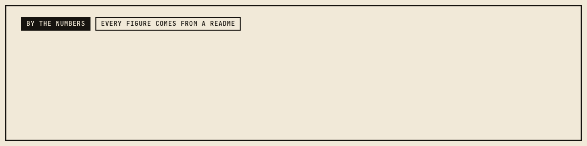
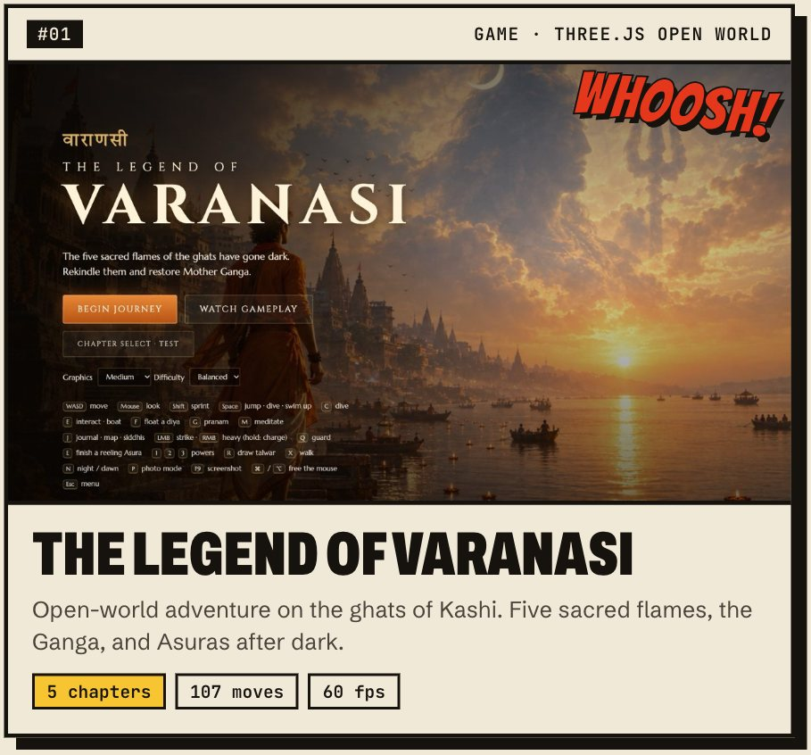
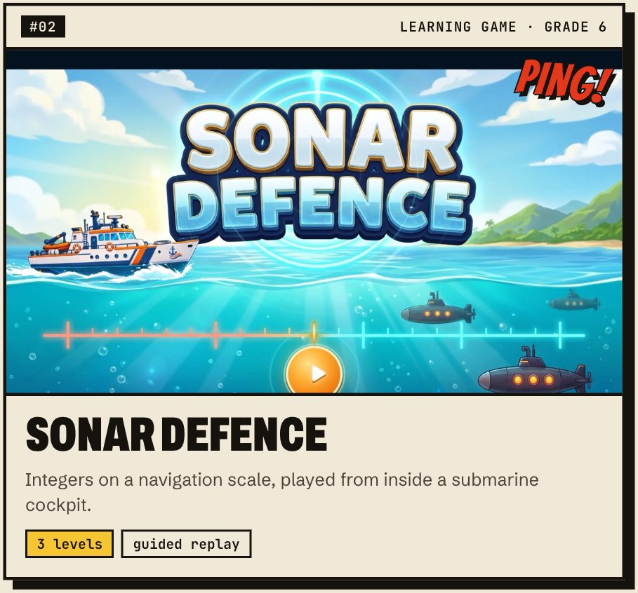
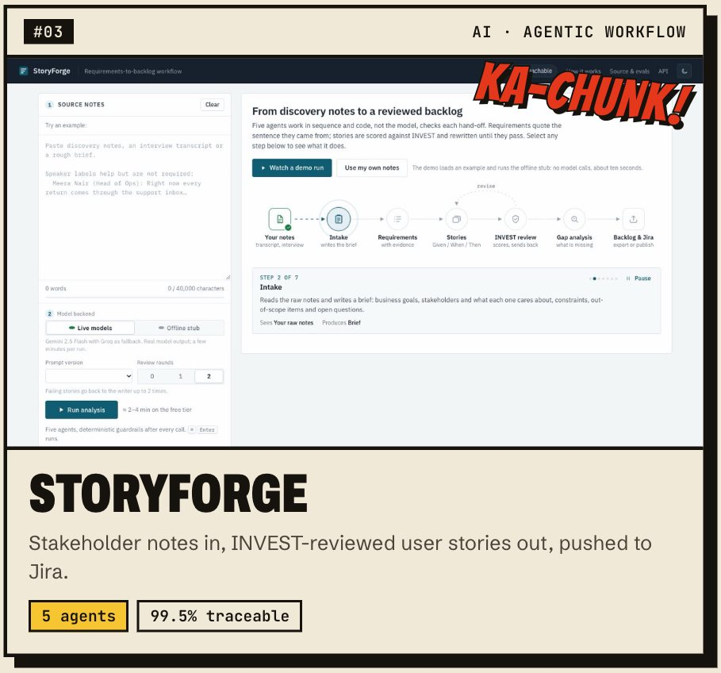
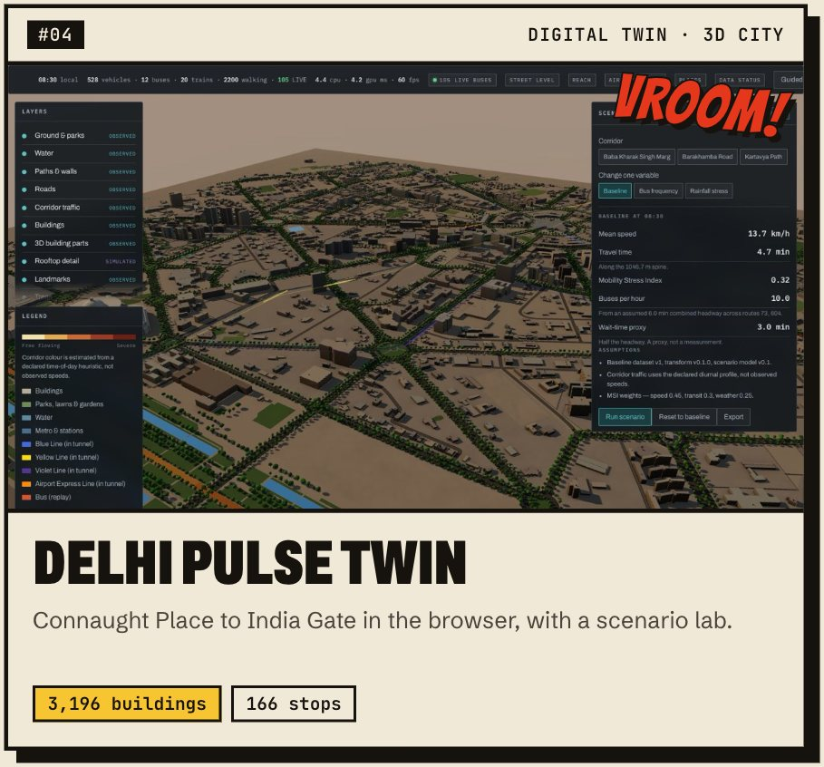
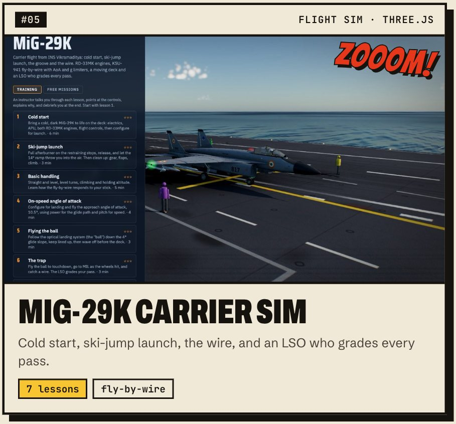
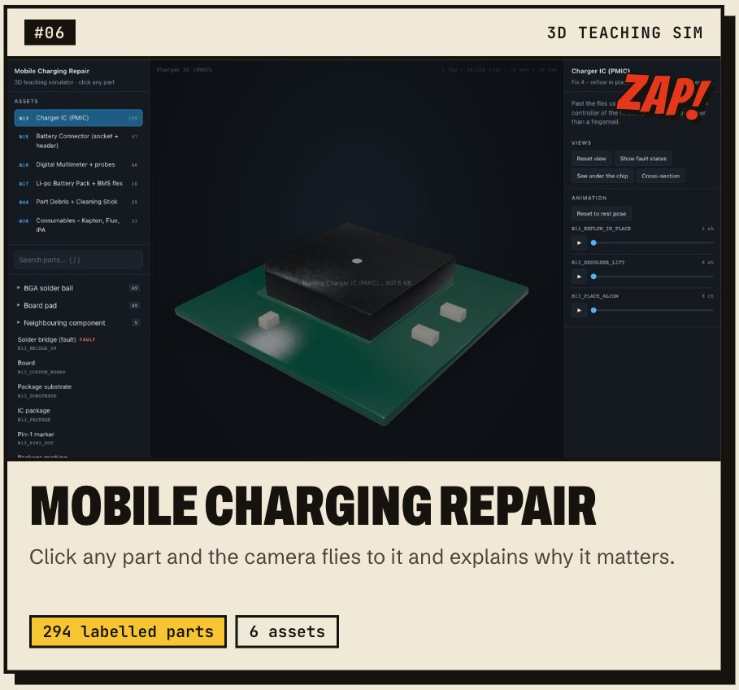
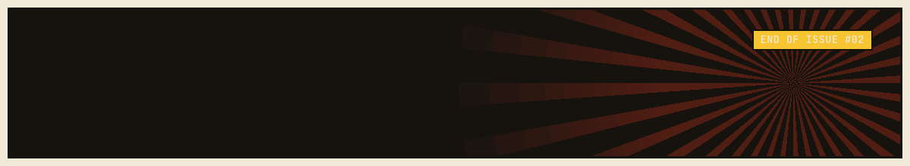

  
  
  

### 🗯️ Previously, on this profile…

**AI Design Associate at [ConveGenius](https://convegenius.ai), Noida.** I design learning games, 3D simulations and AI tools, then I build them and ship them. Business school taught me to write the PRD. The job taught me to keep going until there's something you can play.

- 🎮 **Learning games** for Grades 3–8, in English and हिंदी, with voice, story and a game at the end of every lesson
- 🧊 **3D teaching sims** in three.js, with scenes generated in Blender with Python so a rebuild is one command
- 🤖 **AI tools that check their own work**, like agent pipelines with traceability guardrails and eval sets fixed before any prompt is tuned

### 💥 Featured issues

  
  

  
  

  
  

**Back issues:** [Mistri-ji's Workshop](https://mistri-ji-dun.vercel.app) · [How a Phone Charges](https://charge-simulation.vercel.app) · [The Mela Before Sunset](https://melastory.vercel.app) · [Crossroads](https://crossroad-game-seven.vercel.app) · [Number Flip!](https://cardgame-six-olive.vercel.app) · [OAuth Runway](https://oauth-runwayproj.vercel.app) · [Pirate Cat](https://cat-game-livid-chi.vercel.app) · [Homework Saathi](https://github.com/prradyumn/homework-saarthi) · [the whole archive ↗](https://prradyumn.github.io/Portfolio/#archive)

### 🧰 Utility belt

  

Plus GSAP for motion, Gemini, Groq and Claude Code for AI, and Miro, PRDs and acceptance criteria for everything before the code.

### 🐍 Meanwhile, in the contribution graph…

<picture>
  <source media="(prefers-color-scheme: dark)" srcset="https://raw.githubusercontent.com/prradyumn/prradyumn/output/snake-comic-dark.svg">
  
</picture>

Every animation on this page was written in GSAP and three.js, then rendered frame by frame to GIF. GitHub doesn't run JavaScript, so this is the next best thing. Source in [`_src/`](_src/).
